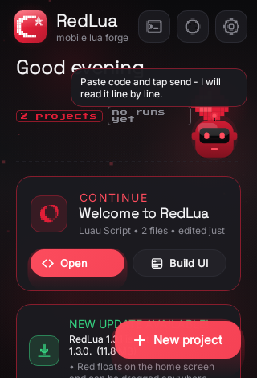
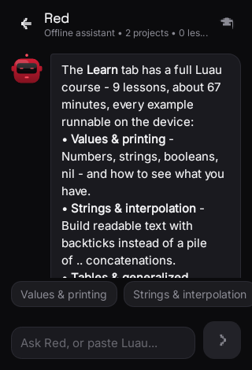
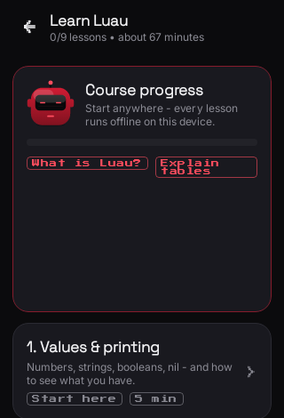
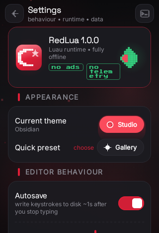

# RedLua

The offline **Luau** editor, no-code app builder and in-app course for Android — plus the update
backend the installed app reads.

| | |
|---|---|
| **Latest** | **RedLua 1.3.1** — [download the APK](https://github.com/kr1-tech/redlua/releases/latest) |
| **Manifest** | [`update.json`](update.json) — the file the in-app updater reads |
| **Requires** | Android 8.0+ |
| **Size** | ~12 MB, signed, no accounts, no analytics |

> Replace `kr1-tech` above with the GitHub account that hosts this repo — it is the only thing this
> README needs edited after the first publish.

## What it is

A pocket-sized Luau workbench that never touches the network unless you ask it to:

- **Editor** — syntax highlighting, completion bar, smart indent, search/replace, snapshots with
  line-by-line diffs.
- **Luau, for real** — type annotations, `continue`, backtick interpolation, `+= … ..=`,
  generalized iteration, if-expressions, bitwise operators, `//`, and Luau's stdlib additions
  (`string.split`, `table.clone/find`, `math.clamp/round/sign/lerp`, `typeof`, `warn`). Errors
  point at the line you wrote, because translation preserves line numbers.
- **Builder** — drop widgets, edit them in the inspector, watch the Luau regenerate.
- **Studio** — 11 theme presets, every token editable, presets saved and shared as JSON.
- **Red** — the mascot assistant. Floats over the home screen, drags anywhere, answers questions
  about the app and about Luau, reads code you paste, runs snippets in the sandbox. Entirely local:
  there is no cloud model behind it.
- **Learn Luau** — nine lessons (~67 min) with runnable examples; the published "expected output"
  is asserted against the real interpreter by the test suite, so the course cannot drift.
- **Updates** — works out of the box: the feed ships with the app, checking is one tap, and a
  "NEW UPDATE AVAILABLE!" banner installs the new build for you.

## Install

Download the APK from [Releases](../../releases/latest) and open it. Android will ask you to allow
installing from this source once.

## Enable in-app updates

From **1.3.1** there is nothing to type: the feed below ships with the app.

1. Install RedLua by hand once (a build older than 1.3.0 has no updater inside it).
2. **Settings → Updates** → tap **Turn on automatic updates** (or the card on the home screen).

That is the whole setup — one tap. The app already knows to read
`https://raw.githubusercontent.com/kr1-tech/redlua/main/update.json`; that address is still an
editable field if you ever want to point it somewhere else.

From then on, a newer release shows the banner on Home with a one-tap install. Android always asks
you to confirm; nothing installs silently.

Update checks are **off by default**. With them off, the app makes no network requests at all.

## Publishing a release

```bash
GITHUB_TOKEN=... python3 tools/publish_to_github.py \
  --repo redlua --version 1.3.1 \
  --apk RedLua-1.3.1.apk \
  --assets RedLua-1.3.1.aab RedLua-1.3.1-source.zip \
  --notes-file RedLua-1.3.1-release-notes.md \
  --notes "One line per change, shown in the update sheet" \
  --files README.md:README.md docs/UPDATES.md:docs/UPDATES.md
```

It creates the release, uploads the assets, regenerates `update.json` from the real download URL
(size and sha256 included) and commits it. `--dry-run` does all of it without touching GitHub.

## Screenshots

| Home | Red | Learn | Updates |
|---|---|---|---|
|  |  |  |  |

## Docs

- [`docs/UPDATES.md`](docs/UPDATES.md) — the manifest format, hosting options, and the two
  permissions the updater adds.
- [`docs/RELEASE-NOTES-1.3.0.md`](docs/RELEASE-NOTES-1.3.0.md) — what changed in the current build.

## Tests

125 Android unit/UI tests and 44 desktop tests pass on this release, covering the Luau front end,
the course's published outputs, Red's answers and code review, the updater ("1.10.0 is newer than
1.9.9", junk manifests, offline failures, install intents) and the shell layout.
